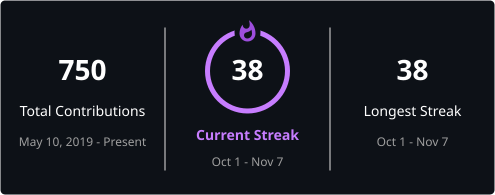
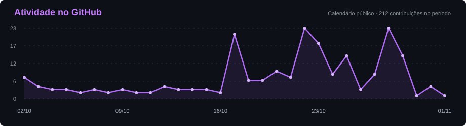

  

## Sobre mim

- Desenvolvedor **Pleno** na **LG lugar de gente**.
- Experiência com **C#/.NET**, desenvolvimento web e bancos de dados relacionais.
- Trabalho com **ASP.NET MVC, SQL Server e NHibernate** e também utilizo **ASP.NET Core, React, TypeScript e Node.js** nos meus projetos.
- No dia a dia, trabalho com **Git/SVN, testes automatizados, integração contínua e manutenção de aplicações web**.
- Interesse em **inteligência artificial aplicada ao desenvolvimento de software e integração de LLMs em aplicações**.

## Tech Stack

### Backend

     

### Frontend

      

### Dados e persistência

     

### Ferramentas e qualidade

         

## GitHub Stats

 

[Recursos visuais e manutenção](docs/profile-design.md)

